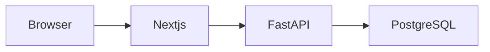

# PaperPilot

PaperPilot helps one adult who already lives in Milan prepare an address change inside the city. The person describes the move in English or Italian, sees whether the papers agree, and files the declaration on ANPR with their own SPID or CIE.

This repository is the local application. It is not a public service, and it does not sign in or submit anything for the person.

The accepted product boundary is [docs/product/PRODUCT.md](docs/product/PRODUCT.md).

## What you can do

- Tell the story of a move inside Milan and get one case, or be stopped when the story is outside this release.
- See the stop: **not ready**, or **ready to hand over**.
- Upload the title paper and, when the case needs it, the identity or permit paper.
- Read the checklist and the review package. The official handoff appears only when the case is ready to hand over.
- Continue in English or Italian. Add `?lang=it` to a page for Italian.

The six screens are Dashboard, Chat, Case, Documents, Checklist, and Review.

## What this release does not do

- It does not store an email, a password, or a verification code. A password field is rejected.
- It does not file the declaration, and it does not promise that the Comune will accept it.
- It does not state a document, a deadline, or an eligibility rule from the research dossier. Those rows are still unreviewed.
- It is not deployed. No host is selected.

Open work is listed in [docs/OPEN.md](docs/OPEN.md). The release decision stays held.

## Contents

- [Requirements](#requirements)
- [Run it](#run-it)
- [Use it](#use-it)
- [Configuration](#configuration)
- [Layout](#layout)
- [Checks](#checks)
- [Further reading](#further-reading)

## Requirements

- Docker, with Compose
- Python 3.12
- Node.js, with npm

On Windows, the Python launcher is `py -3`. That is the command the repository scripts use.

## Run it

From the repository root. The first start creates the virtual environment and installs Python and Node packages. Later starts can begin at `docker compose`.

### Windows

```powershell
docker compose up -d --wait
py -3 -m venv backend\.venv
backend\.venv\Scripts\python.exe -m pip install -r backend\requirements.txt
cd backend
.\.venv\Scripts\python.exe -m alembic upgrade head
cd ..\frontend
npm install
npm run dev
```

### macOS or Linux

```bash
docker compose up -d --wait
python3 -m venv backend/.venv
backend/.venv/bin/python -m pip install -r backend/requirements.txt
cd backend
.venv/bin/python -m alembic upgrade head
cd ../frontend
npm install
npm run dev
```

Then open [http://127.0.0.1:3000](http://127.0.0.1:3000).

| Service | Address | Role |
|---|---|---|
| Site | [http://127.0.0.1:3000](http://127.0.0.1:3000) | The screens |
| API health | [http://127.0.0.1:8000/health](http://127.0.0.1:8000/health) | Compose API, expected body `{"status":"ok"}` |
| Database | `127.0.0.1:5432` | Database `paperpilot`, user `postgres`, no password |

The site forwards `/v1` to the API on port 8000. Leave that port to Compose. A second API on the same port will not share it.

`alembic upgrade head` creates the tables. The database image only enables pgvector. Run the upgrade before using the site. If the virtual environment already exists, skip the `venv` and `pip install` lines.

Stop the containers with `docker compose down`. The database volume stays. `docker compose down -v` removes that volume.

## Use it

On the dashboard, write the move in the text box and continue. A supported story opens one case and keeps a session cookie. An excluded story does not open a case. Reloading the dashboard shows the same case.

There is no account page. Signing in to ANPR happens on the official service, outside this application.

## Configuration

Copy nothing that contains a secret. This repository has no password and no API key in its env files.

| Name | Default | Used for |
|---|---|---|
| `PAPERPILOT_DB_HOST` | `127.0.0.1` | Database host for a process on the machine |
| `PAPERPILOT_DB_PORT` | `5432` | Database port |
| `PAPERPILOT_DB_NAME` | `paperpilot` | Database name |
| `PAPERPILOT_DB_USER` | `postgres` | Database user |
| `PAPERPILOT_ENV` | unset | `production` hides the API docs |
| `PAPERPILOT_UPLOAD_DIR` | a directory under the API | Where an upload is stored |
| `PAPERPILOT_MODEL` | unset | `local` keeps the model call on this machine during checks |

The names above for a host process are also in [.env.example](.env.example). Inside Compose, the API uses host `postgres` and port `5432`.

Two more local Compose projects exist. They are still on this machine:

- Staging, [.env.staging](.env.staging): API port 8001, database port 5433.
- Production lock, [.env.production](.env.production): API port 8002, database port unpublished, API docs hidden.

## Layout

```text
frontend/     Next.js screens. They display the case and do not decide ready.
backend/      FastAPI. The only writer of the case.
database/     PostgreSQL image notes and the pgvector init script.
evaluation/   Walks for retrieval, release, and the empty beta.
docs/         Product, research, architecture, and the task list.
scripts/      One check per concern. Each prints a single result line.
```



Next.js does not call the model. FastAPI decides whether the case is ready. One owner per job is set out in [docs/architecture/COMPONENTS.md](docs/architecture/COMPONENTS.md).

## Checks

From the repository root, after the database is up:

```powershell
py -3 scripts/check_tasks.py
```

That prints the next task id. The release walk stays held:

```powershell
py -3 scripts/check_release.py
```

Other checks live in [scripts](scripts) and record their reports in [docs/testing](docs/testing). The private beta has no session. `py -3 scripts/check_beta.py` prints `beta held`.

## Further reading

- [docs/product/PRODUCT.md](docs/product/PRODUCT.md) — what the first release is
- [docs/product/MVP_SCOPE.md](docs/product/MVP_SCOPE.md) — the supported case and the exclusions
- [docs/product/NAVIGATION.md](docs/product/NAVIGATION.md) — the six screens
- [docs/OPEN.md](docs/OPEN.md) — unfinished tasks and open decisions
- [docs/DECISIONS.md](docs/DECISIONS.md) — accepted and open decisions
- [database/README.md](database/README.md) — the local database

No license file is included in this repository.
