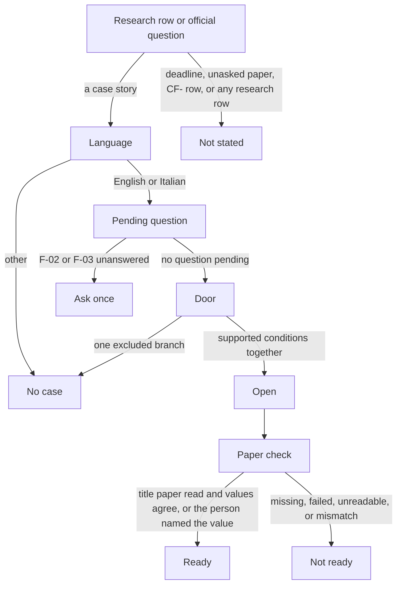

# Requirements engine

Task 24. Written on 2 November 2026. The stops are in [STATES.md](STATES.md). The fields are in [INTAKE.md](../product/INTAKE.md). The boundaries are in [MVP_SCOPE.md](../product/MVP_SCOPE.md). The dossier is in [DOSSIER.md](../research/DOSSIER.md).

This file is the decision table and the order FastAPI evaluates it. It is not a loader, an API, or a rule the agent may state. The model may propose an extracted name and address. It does not choose the door, a value when two papers disagree, or the stop.

The dossier version is 2026-11-02. Every research row stays unreviewed. A revision does not promote a row. Age is not an input.

A rule row is stored apart from passage text. It may cite passage ids. R-01 through R-08 cite product documents, not government passages. No current rule cites a government passage as approved evidence. An unknown, contradictory, outdated, or invalidated government input stays on R-09. Retrieved text cannot flip R-09, and a write cannot promote a row.

## Decisions

| ID | When | Inputs | Decision | Scenarios | Source |
|---|---|---|---|---|---|
| R-01 | The message is not English or Italian | F-01 | no case | U-03 | [MVP_SCOPE.md](../product/MVP_SCOPE.md) |
| R-02 | The story is an excluded door. The answer names that door and adds no steps. | The story | no case | U-01, U-02 | [MVP_SCOPE.md](../product/MVP_SCOPE.md) |
| R-03 | The story is ambiguous and the question has not been asked. A second ask is refused. | F-02 or F-03 | ask once | A-01, A-02 | [INTAKE.md](../product/INTAKE.md) |
| R-04 | The answer to that question excludes | F-02 or F-03 | no case | A-01, A-02 | [MVP_SCOPE.md](../product/MVP_SCOPE.md) |
| R-05 | The supported conditions hold together | F-02 through F-06, as the intake requires them | open | S-01, S-02 | [MVP_SCOPE.md](../product/MVP_SCOPE.md) |
| R-06 | The title paper is missing, failed, or unreadable | F-07 | not ready | I-01 | [INTAKE.md](../product/INTAKE.md) |
| R-07 | The papers disagree and the person has not named the value | F-09 | not ready | I-02 | [INTAKE.md](../product/INTAKE.md) |
| R-08 | The title paper was read and the name and the new address agree, or the person named the value. S-02 does not require the identity paper. | F-07, F-09, and F-08 when the intake requires it | ready | S-01, S-02 | [INTAKE.md](../product/INTAKE.md) |
| R-09 | The question is a deadline, an unasked paper, the only sign-in method, a CF- row, or any other research row. Both wordings stay. The engine does not choose. The case, if open, stays as it was. | The research id | not stated | S-01, S-02, I-01, I-02, A-01, A-02, U-01, U-02, U-03 | [DOSSIER.md](../research/DOSSIER.md) |

## Order

Official-unknown first, then language, then a pending question, then the door, then the paper check. One excluded branch is enough to refuse. Opening requires the supported conditions together. The paper check runs only after a case exists.

