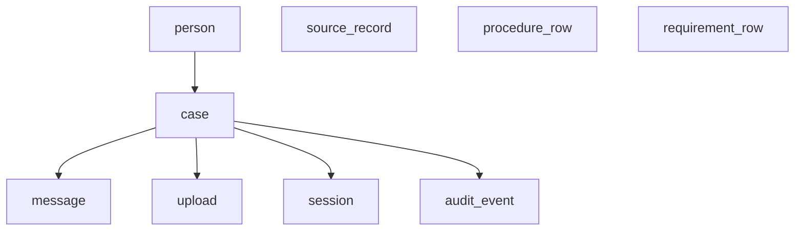

# Database schema

Task 22. Written on 2 November 2026. The owners are in [COMPONENTS.md](COMPONENTS.md). The fields are in [INTAKE.md](../product/INTAKE.md). The blocked states are in [ERRORS.md](../product/ERRORS.md).

This file is the tables and the deletion rule. It is not SQL, an API, or a rule the agent may state. Stops other than not ready and ready to hand over stay in Task 23. The rule engine stays in Task 24.

FastAPI is the only reader and the only writer. An excluded story inserts nothing. The person row stores an id only. It does not store a credential, an email, or a SPID or CIE secret. There is no profile table. F-01 through F-06 live on the case.

## Personal

These rows are deleted with the person. The files named by `upload` are deleted with those rows.

| Table | What it holds | Constraint |
|---|---|---|
| `person` | The opaque id. This is the user. | One row per person. |
| `case` | One open case. Language, the continuing answers F-02 through F-06, the one missing field, and the stop: not ready, or ready to hand over. The named name and the named address, only after the person names which value is correct. | One open case per person. The CH-01 link is not a column. |
| `message` | The thread, in order. | Ordered by case. |
| `upload` | The current title paper, and the identity or permit paper when the intake requires it. Status is failed, unreadable, or read. The path is on the API process. A read row holds the extracted name and the extracted address. | One current row per case and role. |
| `session` | The agent turn: the case and the question still missing. | Expiry does not delete the case. Resume reads the case. |

Ready is set only when the title paper was read and the name and the new address agree, or the person has named which value is correct. The schema does not choose. A failed or unreadable upload does not fill the extraction. Replacing a paper deletes the old file and the old mismatch. After the person names the value, the case stores that name and that address, and the two readings are cleared.

## Knowledge

These rows have no personal column. Deleting a person does not delete them. The wording stays in the research files. A write cannot promote a row.

| Table | Points at | Review |
|---|---|---|
| `source_record` | [SOURCES.md](../research/SOURCES.md) | unreviewed |
| `procedure_row` | [PROCEDURE.md](../research/PROCEDURE.md) | unreviewed |
| `requirement_row` | [DOCUMENTS.md](../research/DOCUMENTS.md), [DEADLINES.md](../research/DEADLINES.md), [SUBMISSION.md](../research/SUBMISSION.md), or [RELATED.md](../research/RELATED.md) | unreviewed |

Each row is an id, the file it points at, and the review status.

## Audit

`audit_event` records that a case was opened, an answer was saved, an upload was replaced, a value was named, or the stop became ready. It stores no file bytes and no credential. It is deleted with the case.

## Indexes

- One open case per person.
- Messages ordered by case.
- One current upload per case and role.
- Knowledge lookup by id.
- Audit lookup by case.
