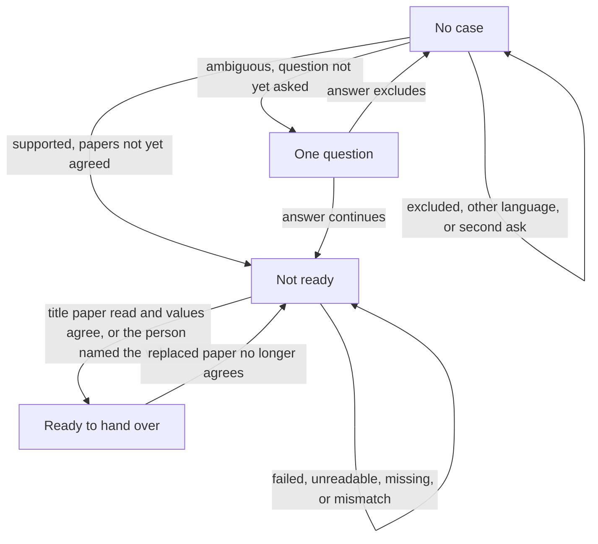
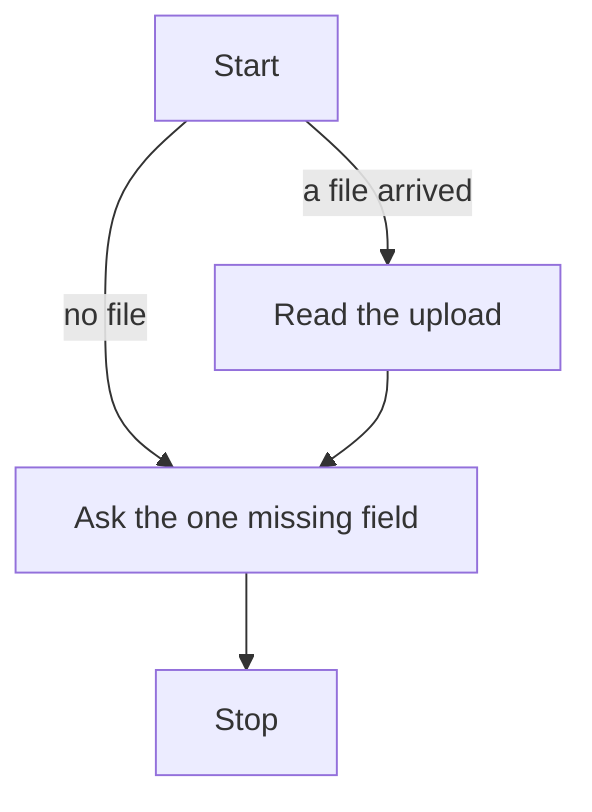

# Case states

Task 23. Written on 2 November 2026. The tables are in [SCHEMA.md](SCHEMA.md). The blocked states are in [ERRORS.md](../product/ERRORS.md). The journeys are in [JOURNEYS.md](../product/JOURNEYS.md).

This file is the stops and the transitions. It is not SQL, an API, or a rule the agent may state. FastAPI writes the stop. The model does not.

A case stores two stops: not ready, and ready to hand over. No row is the third stop. Collecting an answer and waiting for a paper are not ready. The paper check runs inside the turn and is not a stored stop. Ready to hand over is the package. It is not completed. Coming back shows the same package. The system does not learn that the Comune accepted it. Blocked is not ready, with the E- row.

A session may exist on the person before a case exists. It holds at most one question, F-02 or F-03. An excluded answer deletes that question and inserts nothing.

## Case

| From | Trigger | Guard | To |
|---|---|---|---|
| No case | Supported story. S-01 and S-02. | English or Italian. Not already an open case. | Not ready. The same turn sets ready when the papers already agree. |
| No case | Ambiguous story. A-01 or A-02. | The question has not been asked. | The session holds F-02 or F-03. Still no case. |
| No case | Excluded story. U-01 or U-02. Or the answer to F-02 or F-03 excludes. | The door is already named. | No case. The question, if any, is deleted. |
| No case | Language other than English or Italian. U-03. E-08. | | No case. |
| No case | The story still does not classify. E-06. | The one question was already asked. | No case. Do not ask again. |
| Not ready | Upload read. | The title paper was read, and the name and the new address agree, or the person named which value is correct. | Ready to hand over. |
| Not ready | Upload failed. E-01. Or the paper is unreadable. E-02. Or the title paper is missing. I-01. E-04. Or the papers disagree. I-02. E-03. | | Not ready. A failed or unreadable upload does not fill the extraction. |
| Ready to hand over | The person replaces a paper. | The check no longer agrees. | Not ready. |
| Either stop | The session expires. E-07. | | The same stop. The unanswered question and the uploads stay. Resume does not start the story again. |
| Either stop | She asks for a deadline, an unasked paper, or the only sign-in method. E-05. | | The same stop. |

A second case, a credential, a model write of the stop, or a transition to accepted is refused. The stored stop stays. Where an E- row already has a message, that message is the reply.

## Turn

One synchronous request. It is not stored.

The turn reads the upload when one arrived, asks the one missing field, then stops. Session expiry drops the turn and keeps the case. An unavailable source leaves the case as it was.
