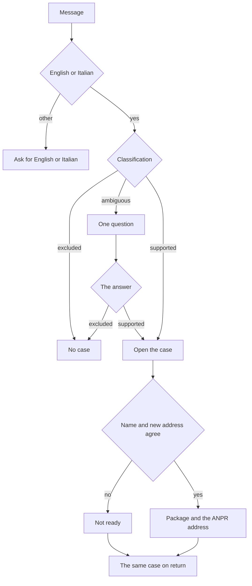

# User journeys

Task 15. Written on 2 November 2026. The nine requests are in [SCENARIOS.md](SCENARIOS.md). The case boundary is in [MVP_SCOPE.md](MVP_SCOPE.md). The conflicts are in [DOSSIER.md](../research/DOSSIER.md).

A journey is the sequence for one of those requests: what the person does, what PaperPilot answers, and where it stops. It does not state a document class, a deadline, or an eligibility rule that the dossier left unresolved. It does not choose a sign-in method. It does not take a password, file the declaration, or say the Comune will accept it.

## Shared path

The person starts by writing a message. There is no separate menu of procedures.

One question is asked only for an ambiguous story, and only once. The next message is classified. It is not asked again.

A supported story opens one case. The case holds the conversation, the uploads, what is still missing, and, when the papers agree, the review package. An excluded story does not open that case. When [MVP_SCOPE.md](MVP_SCOPE.md) already names a door, the answer names that door and does not add steps.

The paper check compares the lease or the ownership paper, and the identity or permit document, with the name and the new address. A missing, unreadable, or contradictory paper blocks ready. PaperPilot does not pick a value.

Ready means ready to hand over. The package shows the ANPR address recorded as CH-01 in [SUBMISSION.md](../research/SUBMISSION.md): https://www.anagrafenazionale.interno.it/servizi-al-cittadino/. The person signs in and sends. Opening that page is not acceptance.

Return opens the same case. Nothing is asked a second time if it is already in the case. This does not read ANPR status or the IO app.

## S-01 Tenant, English

The story already says she is one adult, already resident in Milan, moving to Via Torino 20, named on the lease, with a permit that can be attached.

| Step | Person | PaperPilot | Stops |
|---|---|---|---|
| 1 | Sends the English request | Classifies it as supported. Opens the case. Does not ask the A-01 or A-02 question. | Case open |
| 2 | Uploads the lease, the passport, and the permit | Compares them. The name matches, and the lease address is Via Torino 20. | Ready to hand over |
| 3 | Reads the package | Shows the package and the CH-01 address. Does not take the SPID password and does not file. | She submits herself |
| 4 | Comes back later | Shows the same package. Does not read ANPR status. | Same case |

## S-02 Owner, Italian

The same path as S-01, in Italian. The ownership paper takes the place of the lease. The story already says the declaration is only for her.

| Step | Person | PaperPilot | Stops |
|---|---|---|---|
| 1 | Sends the Italian request | Classifies it as supported. Opens the case. Answers in Italian. | Case open |
| 2 | Uploads the ownership paper | The paper shows her name and via Savona 12. | Ready to hand over |
| 3 | Reads the package | Shows the package and the CH-01 address. Does not take the CIE and does not file. | She submits herself |
| 4 | Comes back later | Shows the same package. | Same case |

## I-01 No proof of title

The story matches the supported case. The lease or the ownership paper is absent.

| Step | Person | PaperPilot | Stops |
|---|---|---|---|
| 1 | Sends the request | Classifies it as supported. Opens the case. | Case open |
| 2 | Uploads the passport and the permit, and says the contract is not on the phone | Asks for the lease or the ownership paper, and says her name must be on it. | Not ready |
| 3 | Leaves | Does not tell her to send the declaration anyway. Does not mark the package ready. | Not ready |
| 4 | Returns with no new paper | Shows the same missing paper. Does not ask the story again. | Not ready |

## I-02 Papers disagree

The case is supported. The uploads do not agree.

| Step | Person | PaperPilot | Stops |
|---|---|---|---|
| 1 | Sends the request and the uploads | Opens the case. | Case open |
| 2 | The permit shows Via Padova 10. The lease shows Via Torino 20. The surname on the lease is spelled differently from the passport. | Shows those two mismatches. Does not pick a value. | Not ready |
| 3 | Returns before naming which value is correct | Shows the same mismatches. | Not ready until she names the value |

## A-01 Already here, or just arrived

"I moved to Milan last month. I need residence." That is not enough to open a case.

| Step | Person | PaperPilot | Stops |
|---|---|---|---|
| 1 | Sends that request | Asks once whether she is already registered as a resident of Milano. | Waiting |
| 2a | Says yes | Continues as a supported case and collects what is still missing. | Case open |
| 2b | Says she arrived from abroad and was never registered in an Italian municipality | Does not open the case. Names the Comune di Milano platform for foreigners arriving from abroad, the door YesMilano describes. Adds no steps. | No case |
| 2c | Says she was registered in another Italian municipality | Does not open the case. Names ANPR. Adds no steps. | No case |

A second message that only repeats the first request does not earn a second question. The first answer stands.

## A-02 New lease, or moving into someone's home

The new address is in Milan. The title and the household are not known.

| Step | Person | PaperPilot | Stops |
|---|---|---|---|
| 1 | Sends that request | Asks once who is named on the lease or the ownership paper, and whether the declaration is only for her. | Waiting |
| 2a | Named tenant or owner, already resident in Milan, filing alone | Continues as a supported case. | Case open |
| 2b | Guest, or the declaration includes the girlfriend | Does not open the case. For a family move-in, names ANPR and says each adult confirms with their own identity. Adds no steps. | No case |

## U-01 Just arrived from Turkey

| Step | Person | PaperPilot | Stops |
|---|---|---|---|
| 1 | Sends the arrival request | Does not open the case. Names the Comune di Milano service for foreigners arriving from abroad. Adds no steps. | No case |

## U-02 Whole household, and the permit

| Step | Person | PaperPilot | Stops |
|---|---|---|---|
| 1 | Asks to put both adults on the declaration, to file with his SPID, and to update the permits and the TARI | Does not open the address-change case. Does not take the SPID password. Does not start a permit case or a TARI case. | No case |
| 2 | Reads the answer | Says ANPR requires the other adult to confirm with her own identity, that a permit update goes through the Questura path, and that Milan's TARI page is separate. Adds no steps. | No case |

## U-03 Turkish only

| Step | Person | PaperPilot | Stops |
|---|---|---|---|
| 1 | Sends the Turkish message | Does not run the case in Turkish. Asks her to continue in English or Italian. Does not send her to a Turkish copy of the Milan page. | No case |

## What these journeys do not add

Screen layout, field-by-field intake, conversation wording, navigation, error screens, and visual design stay in Tasks 16–20. A day count is not a step. A conflict in the dossier is not a sentence in any answer above.
