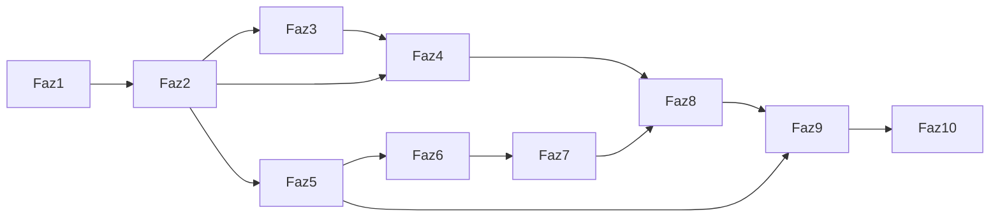

# PracticaMIA — faz dizini

Ayrıntılı görevler on faz dosyasındadır. Bu sayfa sırayı ve çıkış cümlesini tutar. Bir fazın çıkış kontrolü geçmeden sonraki faza geçilmez.

**Goal:** Tek web adresinden kayıt olan kullanıcının İngilizce veya İtalyanca İtalyan bürokrasi sorusunu, resmi sayfalardan alınan parçalara dayanarak LangGraph ile cevaplayıp eski sohbetlerini görmesini sağlamak.

**Architecture:** React kabuğu ve FastAPI aynı Cloud Run sürecinde sunulur. Supabase Auth kimliği taşır. Postgres ve pgvector sohbetleri ve parçaları tutar. LangGraph tur başına en fazla iki Groq çağrısı yapar. Gömüler yerelde `intfloat/multilingual-e5-small` ile üretilir.

**Tech Stack:** Python 3.12, FastAPI, LangGraph, langchain-groq, fastembed, Supabase, Vite, React, TypeScript. Model `openai/gpt-oss-120b`. Supabase Frankfurt. Cloud Run `europe-west1`.

## Sıra

1. [Faz 1 — İskelet](phase-01-iskelet.md). Sağlık ucu ve geliştirme kabuğu.
2. [Faz 2 — Veri](phase-02-veri.md). Tablolar, `match_chunks`, RLS, JWT.
3. [Faz 3 — Arayüz](phase-03-arayuz.md). Kayıt, iki dil, gizlilik, hesap silme.
4. [Faz 4 — Sohbet](phase-04-sohbet.md). Eski sohbetler ve geçici kayıt cevabı.
5. [Faz 5 — Ingest A](phase-05-ingest-a.md). Oturum, vatandaşlık, anagrafe, kimlik.
6. [Faz 6 — Arama](phase-06-arama.md). Dil, 13 konu, hibrit erişim.
7. [Faz 7 — LangGraph](phase-07-langgraph.md). En fazla iki model çağrısı ve doğrulanmış atıf.
8. [Faz 8 — Akış](phase-08-akis.md). Token akışı, kota, geçmiş.
9. [Faz 9 — Korpus](phase-09-korpus.md). B ve C grupları, altın sorular, kaynaklar sayfası.
10. [Faz 10 — Yayın](phase-10-yayin.md). Tek adres, pazartesi taraması, tarayıcı senaryosu.

Faz 5, Faz 3’ten bağımsızdır. Faz 4, Faz 5’ten bağımsızdır. Faz 8 ikisini birden ister.

## Kilit sayılar

- Model `openai/gpt-oss-120b`, sıcaklık `0.1`, çıkış `700` token, tur başına en fazla iki çağrı.
- Gömme `intfloat/multilingual-e5-small`, `384` boyut, önekler `passage: ` ve `query: `.
- Konu eşiği `0.45`. Parça eşiği `0.30`. En fazla `4` parça.
- Kota: kullanıcı `15`, genel `40`, gün `Europe/Rome`.
- Parça `500` sözcük, bindirme `80`. Korpus tavanı `40000` parça.
- Başlık `60` karakter. Geçmiş `6` mesaj, mesaj başına `500` karakter.

Her faz dosyası kendi görevlerinde bu sayıları yeniden yazar. Çelişki olursa faz dosyası uygulanır ve bu dizindeki sayı düzeltilir.
